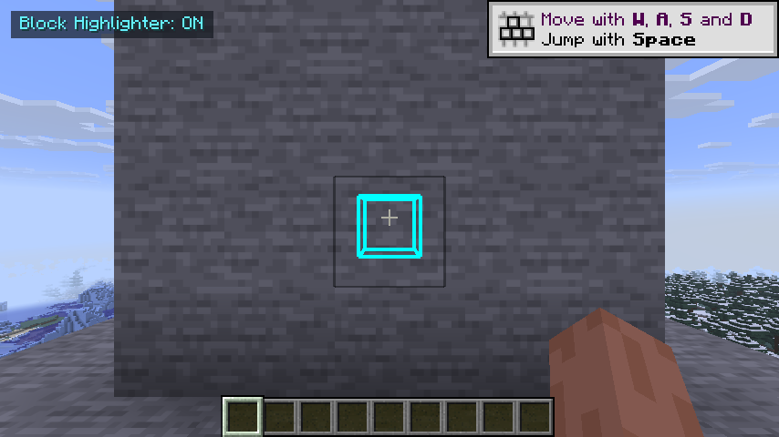

# Block Highlighter

Block Highlighter is a client-side Fabric mod for Minecraft Java Edition 1.21.11. Select block types from the live Minecraft block registry, then see loaded matches within a configurable radius as bright, shape-accurate outlines—even through opaque terrain.

## Requirements

- Minecraft Java Edition 1.21.11
- Fabric Loader 0.19.3 or newer
- Fabric API 0.141.6+1.21.11 or newer for 1.21.11
- Java 21

The mod is client-only. It does not need to be installed on a server and does not send custom packets, change blocks, automate interaction, or bypass server rules.

## Installation

1. Install Fabric Loader for Minecraft 1.21.11.
2. Put the matching Fabric API jar and the built `block-highlighter-1.0.1+1.21.11.jar` in the client `mods` directory. Remove the older Block Highlighter jar so only one version is installed.
3. Start the Fabric 1.21.11 profile.

The build output is created in `build/libs/`. Do not use the `-dev` or `-sources` jars in the game `mods` folder.

## Controls

| Control | Default key | Description |
| --- | ---: | --- |
| Open Block Highlighter | `/blockhighlighter` or `/bh` | Open the selector and settings screen |
| Toggle Block Highlighting | H | Enable or disable outline rendering and scanning |
| Add Looked-at Block | J | Add the block under the crosshair; hold Shift to remove it |

The toggle and quick-add controls are registered with Minecraft's normal key binding system and can be changed under **Options → Controls → Key Binds**. The selector is opened with the client-side `/blockhighlighter` command; `/bh` is a short alias.

The selector commands are client-side and are installed when the client joins a world. After replacing the jar, restart Minecraft and join the world again before trying `/bh`; they do not need to exist on the server.

## Selector and settings

The screen has two scrollable columns:

- **Available Blocks** contains every block currently registered in `Registries.BLOCK`, including blocks without a conventional item form.
- **Selected Blocks** contains the configured block types.

Click an available row to add it and click a selected row to remove it. The search field filters both columns immediately by translated name, registry ID, or a loose fuzzy subsequence match. A confirmation prompt protects **Clear All**.

The settings controls configure:

- highlighting enabled/disabled;
- search radius from 16 to 256 blocks (default 64);
- nearby-world refresh interval from 1 to 120 seconds (default 60);
- the global six-digit RGB color (default `#00FFFF`);
- opacity from 15% to 100% (default 85%);
- line width from 1.0 to 4.0 (default 2.0);
- the small on-screen HUD status indicator.

## Screenshots



This is an in-game screenshot from the manual smoke test, not a mockup. A diamond ore block at `(0, 110, 5)` is completely behind a stone wall at `z=3`; the player is looking toward it from `(0.5, 109, 0.5)`. The cyan outline remains visible while the stone stays opaque. The selector opened with `/bh`, and turning highlighting off removed the outline.

## Configuration

The file is stored at:

`.minecraft/config/block-highlighter/config.json`

Selections are persisted by registry ID rather than display name. A typical configuration looks like:

```json
{
  "configVersion": 1,
  "enabled": true,
  "radius": 64,
  "refreshSeconds": 60,
  "hudEnabled": true,
  "defaultColor": "#00FFFF",
  "opacity": 0.85,
  "lineWidth": 2.0,
  "selectedBlocks": {
    "minecraft:diamond_ore": {
      "enabled": true
    },
    "minecraft:ancient_debris": {
      "enabled": true,
      "color": "#FF8000"
    }
  }
}
```

The current screen exposes the global color; the per-block `color` field is accepted for forward-compatible configuration and can be edited manually. Invalid colors are normalized to the global default. Unknown block IDs are ignored with a warning. Malformed files are copied to a timestamped `.broken` backup before defaults are written. Saves use a temporary file and an atomic move where the filesystem supports it.

## How highlighting works

The scanner discovers only client-loaded chunks inside a conservative bounding box around the configured radius, clipped to the world's build limits. It no longer scans each chunk's entire height or extra chunk rings. Section palettes skip regions that cannot contain a selected block, and scanning starts near the player's Y-level. Matches are updated incrementally instead of waiting for a complete chunk pass. The renderer still applies the exact spherical distance check.

Client block updates are collected without scanning the world. At each **World refresh** deadline, changed positions become eligible and are checked **before** background discovery or periodic rescans. This prevents ordinary block placements from waiting behind a large scan queue. Background scans do not publish pending changes before their deadline. Full chunk packets invalidate their old cache and trigger bounded rediscovery; unloading or changing worlds removes obsolete state.

Refresh timing uses a monotonic real-time clock, not an assumption of 20 client ticks per second. Changing the slider cancels old periodic work, preserves pending changes, and starts a fresh interval. Disabling highlighting or pausing a singleplayer world restarts the interval on resume. Work remains capped at 4,096 block positions and approximately 2 ms per client tick: normal changed positions are handled at the next deadline plus client-tick processing latency, while extremely large bulk updates or initial discovery can still take longer. Removed outlines and shape changes can appear sooner because the renderer independently validates already-known positions.

The renderer rebuilds a world-coordinate vertex buffer only when the cache, player block position, settings, or periodic state refresh changes. It does not rebuild outlines every render frame; the camera transform is supplied dynamically to the GPU. During a rebuild it checks the current state and exact player distance, then asks the state for its current `VoxelShape`. All shape edges are emitted, including multiple boxes, so slabs, stairs, fences, walls, buttons, trapdoors, doors, plants, snow layers, rails, and other non-cubic shapes retain their geometry. Empty outline shapes fall back to collision geometry and then a conservative local block box; air states are skipped.

Minecraft 1.21.11 has a substantially changed render pipeline. The mod uses the 1.21.11 `END_MAIN` world-render drawing event and a dedicated pipeline based on the vanilla line shader's screen-space expansion. Its mod-owned shader omits fog because the reusable buffer stores world coordinates, while the camera transform is applied dynamically. The pipeline uses `NO_DEPTH_TEST`, writes no depth, and renders into the main framebuffer only for the outline draw. Drawing at `END_MAIN` keeps the direct framebuffer result from being overwritten by later world passes. It does not globally disable depth testing or replace terrain textures. A three-buffer GPU ring is used for geometry rebuilds so the render thread does not reuse an in-flight buffer. The pipeline is registered through the public 1.21.11 `RenderPipelines.register` API.

## Performance and compatibility

- No full-world scan occurs per frame.
- Discovery, scanning, pruning, and periodic refresh run on the client thread.
- Rendering is bounded at 8,192 cached positions as a safety valve for selections such as stone over a large radius; the cache itself still records all matches. The uploaded geometry is reused across frames, so this bound does not represent a per-frame world scan.
- Shape queries use the current block state and world, not a static shape for the selected block type.
- No Sodium or Iris internals are used. The custom pipeline is expected to work with vanilla's modern backend and should coexist with common Fabric performance mods. Renderer-specific replacements that bypass Fabric's world-render event may require their own compatibility testing.

## Build

From the repository root on Windows:

```powershell
$env:JAVA_HOME = 'C:\path\to\jdk-21'
.\gradlew.bat build
```

Useful focused checks:

```powershell
.\gradlew.bat test
.\gradlew.bat runClient
```

The automated tests cover color parsing, config round trips, range validation, malformed JSON fallback, search matching, real-time refresh deadlines, interval changes, update-queue eligibility, bounded scan regions, and incremental cache consistency. Rendering requires a graphical development client.

See [refresh timing validation](docs/refresh-timing-validation.md) for the measured 1/5/10/60/120-second live-world checks and native rendering capture for version 1.0.1.

## Manual smoke test

In a development client:

1. Confirm the title screen loads with the Fabric profile and no mixin error.
2. Run `/blockhighlighter`. Confirm both columns contain registered blocks, icons appear when an item form exists, and `diamond` / `minecraft:oak_button` filter immediately.
3. Add a flower, button, slab, stair, and ore. Close and reopen the screen; confirm they remain selected.
4. Toggle with H and verify the HUD/action-bar state changes.
5. Set **World refresh** to 1 second, close and reopen the screen to confirm persistence, and place distinct selected blocks about one second apart. Confirm new outlines follow the selected cadence instead of appearing in a 20–30 second batch. Repeat at 5, 10, 60, and 120 seconds, allowing a full new interval after changing the slider. Also test a large radius while initial discovery is active.
6. Place selected shapes in a test world, put stone between the player and them, and verify the outlines remain visible through the wall without terrain becoming transparent.
7. Change a stair orientation, open a trapdoor, alter a snow layer, connect a fence, break/place blocks, and wait for the incremental cache refresh; confirm the outline follows the current state.
8. Walk into new chunks, change dimensions, leave/rejoin, and join another server. Confirm unloaded or old-dimension positions do not remain visible.
9. Select a common block at a modest radius and verify frame rate remains stable while the scanner progresses.

## Known limitations

- Named presets and preset import/export are intentionally not included in this first stable core implementation.
- Per-block colors are supported by the versioned JSON model, but the compact native screen currently edits the global color only.
- The 8,192-position render safety limit means an unusually broad selection of extremely common blocks may not draw every cached match at once; the cache still records all matches and the selection should be narrowed for complete coverage of very common blocks.
- Some renderer replacements that do not invoke Fabric's 1.21.11 world-render event may require renderer-specific compatibility work.

## License

MIT
