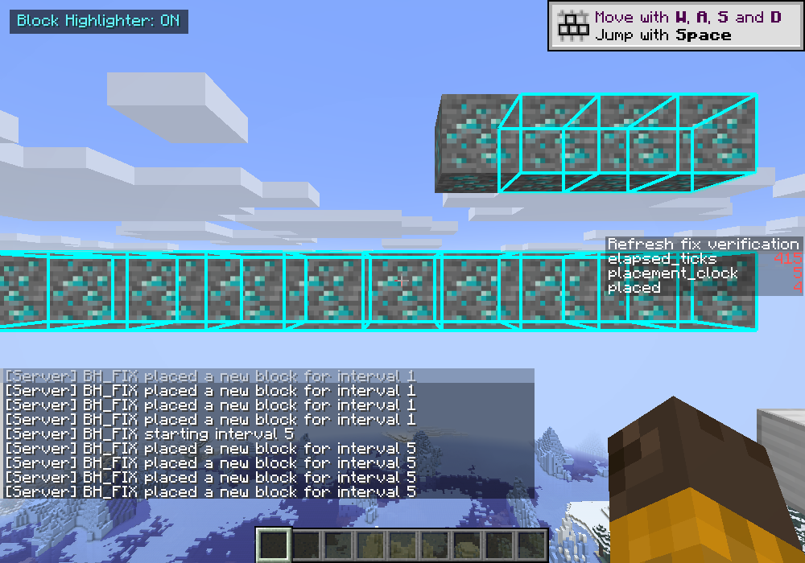

# Refresh timing fix validation

Validated on 2026-10-13 in the Minecraft 1.21.11 development client, using version
1.0.1 of the mod and an isolated copy of the development test world.

## Live-world timing

A test-only datapack placed ten distinct diamond ores, one per second, beginning
0.5 seconds after each interval change. A separate development-only observer
changed the same config field used by the GUI, then measured when each new row
entered the real client highlight cache using `System.nanoTime()`. Different rows
prevented old cached coordinates from producing false positives.

| Selected interval | First cache update after setting change | Radius | Final row |
| --- | ---: | ---: | --- |
| 1 second | 1.089 seconds | 16 blocks | 10/10 found |
| 5 seconds | 5.094 seconds | 256 blocks | 10/10 found |
| 10 seconds | 10.103 seconds | 16 blocks | 10/10 found |
| 60 seconds | 60.080 seconds | 16 blocks | 10/10 found |
| 120 seconds | 120.099 seconds | 16 blocks | 10/10 found |

For the 1-second case, successive updates occurred at 1.089, 2.084, 3.086, 4.089,
5.078, 6.086, 7.090, 8.081, 9.085, and 10.091 seconds. The maximum-radius case
found five blocks at 5.094 seconds and all ten at 10.094 seconds despite active
background discovery. The live observer reported `BH_FIX_SUMMARY PASS`, and the
client exited normally after saving the isolated world.

These are measured cache-publication times, not a claim of zero rendering or
network latency. The GUI itself was not clicked during this run; its existing
slider writes the same shared config property. Large bulk updates can still
exceed the per-tick work budget. This was not a multiplayer/Sodium benchmark.

## Actual rendering

This separate visual run kept the mod at a 1-second refresh interval throughout.
The lower row is fully outlined; the latest block in the newer upper row is
still awaiting the next deadline. The chat's test-phase names are datapack labels,
not the active setting in this visual-only run. Minecraft's own screenshot API
captured its framebuffer, avoiding unreliable Windows foreground-window capture.
The rendering pipeline was unchanged by this fix.

## Automated and package checks

- All 36 automated tests passed, including monotonic deadlines at all five
  requested intervals, interval rebasing, pause/reset behavior, missed-deadline
  coalescing, pending/eligible update separation, region bounds, and cache counts.
- `gradlew build` succeeded with Java 21.
- The release jar contains the client mixin configuration and remapped Minecraft
  method selectors, and does not contain the development observer.
- Development settings were restored, and the observer was moved out of `run/mods`.
- No installed CurseForge jars were replaced, and no GitHub update was performed.

The local diagnostic fixture, detailed timing log, and observer sources remain
under the ignored `run/` directory; they are not shipped in the mod jar.
